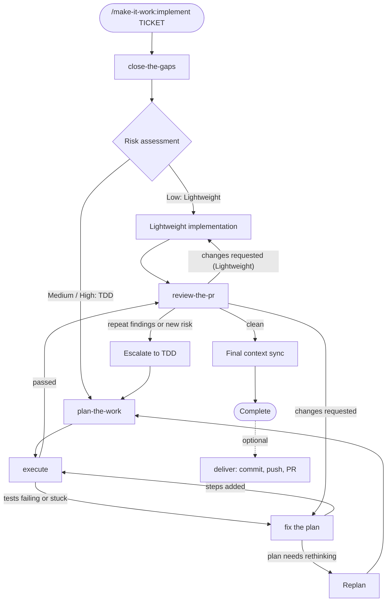

# make-it-work

> From idea to delivery: make your codebase AI-ready with context skills, shape requirements, slice work, plan implementation, review changes against the requirements and codebase guidance — orchestrate an epic with `drive-the-epic`, or take a ticket through implementation with `implement`.

Built for engineering teams working on large, complex codebases. Not greenfield side projects. When your codebase has history, domain rules, and legacy decisions baked in, "generally smart" isn't enough. Claude needs to know *your* project.

## The problem

Claude reads code well. But on a large, long-lived codebase it misses things - domain rules buried in old commits, implicit constraints never documented, business logic spread across layers. It guesses. The bigger the repo, the worse it gets.

`make-it-work` solves this at the source.

## How it works

### `/make-it-work:go-deep`

`go-deep` maps your codebase and builds a structured knowledge base that Claude loads before doing any work:

- **How and what** (always loaded) - two rule files: `architecture.md` is the *how* (domains, components, code areas), `product.md` is the *what* (use cases, actors, business rules).
- **Skills** (loaded on demand) - one per functional domain, one per use case. Each skill is a precise, minimal description of one area of your code - enough for Claude to navigate, not so much it bloats the context.

**The cross-reference map**

Every domain skill points to the use cases it affects. Every use case skill points to the domains it touches. Claude uses these cross-references automatically - when planning a feature it follows links to understand which domains are involved; when planning tests it traces which use cases are affected by a domain change, covering progression and regression without you having to map it out.

**Context efficiency**

Skill descriptions are written to be minimal but precise. Claude reads the description and decides whether to load the skill - it never pulls in unneeded information. The bigger the codebase, the more this matters: Claude gets exactly the context it needs for the task at hand, nothing more. No hallucinating, no misunderstanding, whether planning or executing.

**Staying in sync**

Part of what `go-deep` builds is a hard enforcement rule in CLAUDE.md: before every commit, Claude checks whether any skill or doc needs updating. New domain? Create the skill. Existing domain changed? Update it. Nothing ships without the knowledge base staying in sync with the code.

Run `go-deep` once when you onboard a project.

Fresh projects get numbered domain skills such as `domain-01-authentication`, alongside numbered UC skills. IDs stay stable as domains are added. Existing projects retain their domain naming convention, including unnumbered names; go-deep does not migrate or rename them. The generated CLAUDE.md tells future feature work how to name new domains using that convention.

**What the code can't tell you**

During `go-deep`, Claude asks targeted questions so the how and what files capture what can't be learned from reading the code alone - giving Claude the full picture of the project, not just its structure.

Interactive runs end their turns with written reviews at four checkpoints: scope, project documentation (`CLAUDE.md`, `product.md`, and `architecture.md`), sample skills, and final review. Each includes the actual review material, explains what happens next, and asks you to approve, request changes, or pause through a chat reply. Repair confirmations use the same pattern. Discovery questions still use the available question tool; `--autopilot` keeps its unattended behavior.

The questioning phase reveals what Claude misunderstands about your code - surfacing domain concepts not obvious from reading files, business rules that live only in developers' heads, and assumptions baked into the architecture that were never written down. Answering those questions produces documentation no static analysis tool can generate: the *why* behind the *what*.

The skills produced are also useful outside Claude Code. Product managers can read domain and use case skills to understand what the system actually does, making them a live source of truth for writing requirements.

---

### `/make-it-work:define-test-strategy`

`define-test-strategy` is the onboarding step after `go-deep`: it builds one repo's test-strategy skill, `.claude/skills/test-strategy/SKILL.md`. The skill records where that repo's tests live — including in other repos, such as a separate QA automation repo — how to run each suite and what it needs (env vars, services, CI-only suites), and where new tests of each layer belong. It also builds `.claude/testing/test-map.json`, shared project metadata connecting repo-qualified use cases/domains to tests in any registered repo. Separate, embedded and documentation tests use evidence from assertions, documentation and traced behavior; no source/test files, comments or filenames are changed for mapping. It adds a single `/test-strategy` row to the `CLAUDE.md` Skills Reference and reports current mapped relationships, unresolved scope and confirmed gaps. Freshness checks reuse unchanged mappings and reassess changed tests, code evidence or documentation; unknown impact broadens discovery only where needed. Onboarding/planning/implementation save meaningful map updates; standalone regression/review and report-only requests refresh in memory. These mappings describe test relationships, not sufficient behavioral coverage or passing results. Re-run it and choose "Coverage report only" any time for a fresh view.

Each indexed test records its strategy layer (such as Component or Backend behavior; uncertain or older classifications appear as Unknown). Onboarding, planning and implementation also regenerate `.claude/testing/TEST-MAP.md` after saving the JSON. The developer report shows counts by layer, feature behaviors and test files, unresolved mappings, and an optional collapsed evidence catalog. It is a snapshot of saved metadata, not a test execution or freshness result. The portable `scripts/test-map-report.mjs` prints Markdown by default, writes the report only with `--write`, and checks for drift with `--check`; projects can install it with its `test-map.mjs` dependency and expose `npm run test:map`. Read-only coverage/regression/review requests leave these files unchanged.

When no real tests exist, it discusses the testing strategy as part of onboarding, even if a runner is already configured. It distinguishes current coverage, recommended target coverage and a feasible first adoption phase, then discusses meaningful scope and environment choices before prioritizing individual tests. Every selected layer appears in Layers, Where New Tests Go and Coverage Decision Guidance with `configured`, `planned` or `deferred` status; intended directories can be recorded before they exist. Missing tooling becomes a prerequisite to discuss, with deferred risks and revisit conditions; proposed production refactoring is kept separate from test setup. Test Locations and runnable commands describe actual configuration, while setup commands remain proposals. Planning surfaces required missing layers for readiness, and regression runs configured suites only. Existing suites can receive a focused review when gaps justify it; `--autopilot` chooses and logs defaults, while coverage-report-only skips the discussion. This skill does not install tooling or create tests.

Run it once in each repo, right after `go-deep`; pass `[repo]` to onboard a repo from a workspace root. If `go-deep` hasn't run there, it offers to run it first, or to continue with UC/domain mapping left pending. For older tag-based setups, re-run it to regenerate the strategy/map from current tests and documentation. There is no automatic migration: tag relationships and old rules are not imported, and obsolete rules/pointers require manual cleanup. Existing source/tests remain untouched.

---

### `/make-it-work:run-regression`

`run-regression` runs a project's regression suite - the full suite, one repo's suite (`full:<repo>`), or tests mapped to repo-qualified use-case and domain tokens (e.g. `payments-api:UC-08`, `payments-api:domain-velocity`). One call can mix tokens for several repos. It reads each repo's test-strategy skill for its test locations, commands and prerequisites, queries the maintained map, reuses unchanged relationships and reassesses affected tests/evidence in memory. Missing/malformed maps under the current strategy use temporary discovery without modifying project files; older tag-based strategies need regeneration before scoped selection. Embedded tests use supported runner selectors; when precise selection is unavailable, it discloses the smallest supported enclosing module/package/suite before execution. Unresolved or unselectable embedded portions remain visible even when other mapped tests pass. It falls back to `package.json`/`Makefile`/CI discovery for the full suite when a repo has no strategy. A bare `full` runs each repo's own suite only. Suites that can't run locally (CI-only, missing env vars or services, no tests in the repo) are reported as not run, never as failures. Results are reported live in chat, with nothing persisted to disk.

Use it directly during day-to-day development to check a change against the regression suite, full or scoped. It's also the shared implementation `execute` calls as its completion gate at the end of a plan, instead of writing its own test-running logic.

---

### `/make-it-work:drive-the-epic`

Orchestrates **source intake → shape-the-epic → full-epic review → slice-the-epic**, with saved, resumable progress and an offline HTML dashboard. Accepts ideas, document paths, or a Jira ticket key/URL, including combined inputs. Interactive mode waits for your acceptance of the full epic before slicing; `--autopilot` runs unattended and stays local. Optional Jira publication is offered only after interactive local preparation completes.

```text
/make-it-work:drive-the-epic APP-123
/make-it-work:drive-the-epic path/to/brief.md --autopilot
/make-it-work:drive-the-epic --resume make-it-work/drive-order-exports-<timestamp>
```

Every run keeps its epic, overview, complete slice files, `state.json`, and `dashboard.html` in a dedicated `make-it-work/drive-<title>-<timestamp>/` folder. The dashboard reflects saved progress and waits, links two primary artifacts (Requirement and Slicing summary), and places its decision/transition audit directly after them. Slice detail, dependencies, and parallel candidates live in the summary Markdown and linked slice files. The dashboard refreshes every 15 seconds while active or waiting, then stops refreshing at completion or a stop. The state file retains inputs, decisions, and history; one temporary event file is removed after successful checkpoints. Resume reuses decisions and revisits only affected work when requirements change.

Generated Markdown names stay short because the run folder already identifies the epic:

```text
make-it-work/drive-order-exports-<timestamp>/
  dashboard.html
  requirement.md
  slicing-summary.md
  S-1-export-orders.md
  S-2-date-filter.md
  state.json
```

Full titles remain inside the documents. Preserved revisions use `-v2`, `-v3`, and later suffixes; dashboard, overview, and prerequisite links use the actual generated paths. Existing artifacts keep their names until a new version is generated.

The workflow ends with **preparation complete** and a starting slice for a separate `implement` run. Unresolved requirements remain visible. The handoff reserves per-slice implementation progress so a future phase can coordinate sequential and parallel `implement` runs; this version does not start them.

---

### `/make-it-work:shape-the-epic`

Shapes an epic for any work management tool (Jira, Azure DevOps, Linear, Shortcut) in **Product** or **Technical-debt** mode. Choose the readiness categories to focus on, then work through the discovery interview and gap-check. After the interview, it generates the complete Markdown epic directly for consolidated feedback, without a category-by-category content approval round. Real unknowns remain scoped TBDs; unselected categories are marked **Not assessed**.

Product mode covers value proposition, users and permissions, KPIs, use cases, rollout, and completion. Technical-debt mode centers on evidence and impact, desired outcomes, testable acceptance criteria, verification, and scope boundaries. Material agreed constraints or external dependencies are optional. The skill does not collect ownership; implementation planning is outside the default technical-debt epic. `--autopilot` resolves selection and interview questions unattended and adds an audit log.

When explicitly instructed to update a Jira ticket, it publishes the entire saved epic, including the complete Decision log, open items, and readiness checklist, and verifies the updated description. The separate autopilot JSONL audit file is included only if specifically requested.

---

### `/make-it-work:slice-the-epic`

Offers 2–3 tailored slicing techniques or combinations, recommends one, and lets you choose before generating the backlog. Each slice has a stable ID and acceptance criteria or technical completion evidence, with a default sizing guideline of half a sprint when team expectations are unknown.

Saves a shared overview at `make-it-work/slices-[epic-title]-[timestamp].md` and a separate complete Markdown file per slice alongside it. Prints a summary table of every slice, its outcome, hard prerequisites, recommended predecessors, and implementation stage in the terminal and saves the same table in the overview, with links to individual slice files. The overview also includes a Mermaid dependency map, a readable dependency relationship table, and recommended implementation stages. Distinguishes hard prerequisites from preferred sequencing, identifies parallel work, and proposes an MVP boundary.

After saving, interactive runs offer optional Jira creation when a usable integration is available. Proposes Story for user-facing slices and Task for technical work, lets you adjust, asks for missing mandatory values, and offers the source Jira Epic as parent when applicable. The creation offer includes native **blocks / is blocked by** links for the hard dependencies, showing their direction and count. It creates approved links once both tickets exist, reuses existing links, and keeps recommended sequencing informational. When you approve creating the slice tickets under the original Jira ticket, it also posts the entire saved overview there as a comment, converting the Mermaid diagram to a readable plain-text dependency list. All tables, assumptions/open questions, implementation flow, MVP, and ticket/link results remain included; local Markdown retains Mermaid. A source reference alone does not trigger a comment, and older creation-only consent does not silently authorize links. Reports ticket, link, and comment results separately; retries require your request and preserve successful operations. `--autopilot` saves all files and skips Jira creation, linking, and commenting without prompting.

Use it when a ticket or epic feels too big and needs to become sprint-sized stories. Tell Claude things like "this ticket is too large," "break this into smaller pieces," or "help me write user stories for this epic," or invoke it directly with `/make-it-work:slice-the-epic`.

---

### `/make-it-work:find-the-repos`

`find-the-repos` first checks whether the ticket's exact identifiers, endpoints, and UI labels already exist, leading the report with **verify and finish** when implementation is found. It then shortlists repos using docs, domain/use-case skills, and bounded code searches; specific code evidence can establish **Definite** even without docs. Workspace detection accepts catalog metadata, repo lists, and workspace configs as well as CLAUDE.md. It assesses **all repos by default**, even in a large sibling-repo workspace without grouping metadata; no repo-selection round is required. You can explicitly narrow the scope. Genuine workspace/scope choices use AskUserQuestion when available, without giant checkbox lists. One report, `<TICKET>-repos.md`, holds all assessment details, ownership sources/conflicts, and external routing; comments, revisions, and confirmation update that same file. The terminal shows only a compact **Definite repos / Owner(s) / Evidence** table, with supporting types `product.md`, `architecture.md`, `context skills`, and/or `code`, plus a report link and review prompt. Pasted tickets can use a provisional slug without borrowing related ticket keys.

Unlike the fixed `close-the-gaps → plan-the-work → execute → review-the-pr` pipeline, `find-the-repos` ships standalone: nothing else in this plugin calls it yet. Run it on its own, before that pipeline starts, whenever a ticket's home repo isn't already obvious.

---

### `/make-it-work:close-the-gaps`

`close-the-gaps` acts as a Product Analyst before development begins. It loads the project skills relevant to the ticket, digs into the affected code, and surfaces every gap - unclear language, missing edge cases, conflicting requirements, unstated assumptions - then walks you through them one question at a time. It can also run in an **offline mode** — export every question to a file to answer outside the session, then re-invoke pointing at that file to inject the answers and resume — for when the person who can answer isn't available live. **Slack modes** prepare every question as a direct message to the ticket's Product Manager: `--slack` saves a draft for you to review and send; `--slack-send` explicitly authorizes sending directly to the confirmed PM. Both use a friendly greeting, a clickable ticket link when available, thread-reply instructions, and a short disclosure that the message was generated by make-it-work, an AI workflow by InsideOut AI. Re-invoking with the saved questions file reads the PM's thread replies. Without a mode flag, the initial choice is **Answer here**, **Draft in Slack**, **Send via Slack**, or **Export to a file**, with Slack options shown when supported. In Guided and Autonomous, `implement` asks where refinement questions should go separately from autonomy, discovers deferred Slack tools, and offers supported Slack actions. When Slack is unavailable, it explains the limitation and asks whether to answer here or stop for Slack setup. It saves the destination independently; refinement asks for a missing choice before asking product questions, including on older interrupted runs. Both Slack choices pause for replies. Autopilot defaults to answering here unless Slack was explicitly requested; sending is never chosen automatically. Delivery metadata distinguishes drafts, confirmed sends, and uncertain results, so resume does not send duplicates.

The output is a Gherkin-ready refined spec. Unknown unknowns become explicit. Requirements are solid before a single line of code is written.

Teams use it before refinement meetings so developers arrive with focused questions rather than discovering gaps mid-discussion. Or post the output directly to the Jira ticket for product to review asynchronously - no meeting needed for straightforward tickets.

The cost of a vague ticket is paid in rework. `close-the-gaps` closes the gaps before the first line of code.

---

### `/make-it-work:plan-the-work`

Turns an agreed spec or refined ticket into an execution-ready implementation plan before implementation logic is written. It loads the project's guidance and relevant skills, investigates the real code paths across one or more repositories, closes technical and scoping gaps with you, and writes an atomic, verifiable plan to `make-it-work/<TICKET>/<TICKET>-plan.md`. When the target project has a test framework configured, it also writes and confirms each step's progression (red) and regression (currently-passing) tests — including minimal, clearly-marked stub signatures on a typed or dynamic stack where needed to reach a valid runtime red state — left uncommitted in the working tree; projects with no test framework configured are unaffected. With a test-strategy skill, new tests go where the strategy says and are registered in the product repo's map with evidence and runner identities/selectors, without mapping comments in source/tests. Planning may edit embedded test code in implementation files while leaving existing implementation logic unchanged. A QA repo that receives tests joins the plan as test scope. The plan also records the domains and use cases it touches for the regression gate.

Pass a ticket ID or a spec path, or let the skill derive the ticket from the current branch. Use it after `close-the-gaps` and before implementation so another engineer or agent can execute the work step by step without guessing.

---

### `/make-it-work:execute`

Implements a plan `plan-the-work` already wrote, step by step: it writes each step's code, re-runs that step's tests until they pass with a 5-attempt retry limit before asking for help, and halts the whole plan - rather than guessing - whenever a failing test looks like a real product-behavior question instead of a test bug. Once every step is green, it runs `run-regression` as a completion gate — the tests mapped to the plan's touched domains/use-cases across registered locations, plus the full suites required by its existing product-repo verification policy, or just the full suite when the plan records no tokens or none of their repos has a test strategy — and stops for your triage on a gate failure instead of trying to auto-fix it. It never commits on your behalf, leaving all finished work in the working tree for you to review.

Pass a ticket ID or a path to a plan file, or let the skill derive the ticket from the current branch. Use it after `plan-the-work` to turn an execution-ready plan into actual code, completing the `close-the-gaps` → `plan-the-work` → `execute` → `review-the-pr` pipeline.

---

### `/make-it-work:review-the-pr`

Acts as a reviewer grounded in the project's own documentation instead of generic intuition. Runs three passes - business correctness against the `uc-*` skills, regression safety against the `domain-*` skills and architectural constraints, and coding standards against `CLAUDE.md` - then a docs-sync check to confirm skills were updated alongside behavior. A relevant new or changed test missing from the shared map, or with a stale relationship, is flagged as Minor. Review refreshes relevant relationships in memory without saving project metadata; source annotations are never required, and uncertain scope remains unresolved. Emits a verdict-first, evidence-dense report, both as a pasteable file and a scannable chat summary.

Use it to review a pull request or diff in any repo that keeps the `go-deep` knowledge base (`CLAUDE.md` plus `uc-*`/`domain-*` skills and `.claude/rules` docs).

---

### `/make-it-work:implement`

Orchestrates the whole pipeline for one ticket: it checks that the project has its `go-deep` context, runs `close-the-gaps`, assesses the ticket's risk, implements it in the matching mode, reviews it with `review-the-pr`, and finishes by syncing the project's skills and rules files with what was actually built. It stays thin — each stage skill keeps owning its own reasoning; `implement` decides what runs next, reads each stage's outcome, and enforces the loop limits.

Once the refined spec is saved, new runs assess the ticket as Low, Medium or High risk by judgment over scope, dependencies, architectural impact, security and uncertainty, and record a one-line rationale. Low risk runs **Lightweight**: a fresh subagent implements the spec directly, with whatever checks it chooses and no plan, test-first steps or regression gate; the independent review is the verification, and review findings are fixed directly within the usual fix and review limits. Medium and High risk run **TDD**: today's full `plan-the-work` → `execute` pipeline with its regression gate and fix/replan loops. Every mode keeps the refined spec, the independent review and the final context sync. A Lightweight run escalates once to TDD when a fix breaks what an earlier fix touched, findings repeat in the same area, a finding needs a product decision or replanning, or the implementation reveals more risk; the code already written becomes the TDD plan's accepted baseline. `implement` never downgrades on its own. Force a mode with `--mode lightweight|tdd` or a chat request; the assessment is still recorded alongside the override. Older resumed runs keep the full TDD workflow without assessment.

Before planning (TDD mode), new runs resolve testing readiness for each affected repo. Existing tooling is discovered and its strategy generated/refreshed. With no tooling, Guided offers minimal automated setup or manual verification; Autonomous and Autopilot establish the recommended minimal setup unless manual verification was explicitly selected. Setup includes a real passing behavior test, and its files become the planning baseline. A failed setup cannot silently switch to manual mode. The plan records each repo's verification policy; all-manual execution can complete with observed scenario/AC evidence and `VERIFIED_MANUALLY`, while mixed execution requires both manual evidence and each automated repo's full suite. Manual completion is reported as such, with automated regression unavailable. Older resumed runs keep their original gate behavior.



You choose the autonomy level before the branch decision on a new run. **Guided** pauses for your approval after the spec — showing the assessed risk, mode and rationale, with an option to approve with the other mode — and after the plan; a Lightweight run has no plan gate. Escalations are shown and logged, not asked. **Autonomous** skips those approval gates and replans on its own when the plan stops holding; in both modes, every question a stage asks still comes to you. **Autopilot** runs implementation unattended with each stage's documented safe defaults, creates the ticket-named feature branch automatically when started from the base branch, and leaves all resulting changes uncommitted. It stops with a saved, actionable reason rather than guessing when a required fact is missing, contradictory, or needs a product decision. **`--autopilot`** skips the initial autonomy question and selects the same mode without granting ticket-write permission. For an explicitly supplied, resolved tracker ticket with usable write capabilities, the interactive choices also include **Autopilot + update ticket**. It uses the same Autopilot execution mode and saves the disclosed ticket-update consent without a second prompt; local-spec or unavailable-connector runs keep the three ordinary choices.

During a run, type **"switch to Guided"**, **"switch to Autonomous"**, or **"switch to Autopilot"** in the same Claude Code session. The requested mode is saved and shown as queued; it takes effect at the next phase transition. The current phase, including any open question or approval, keeps its existing mode and still needs its normal answers. A later request replaces the queue; requesting the current mode cancels it. Effective and queued modes persist across interruptions and resume, with no task restart or bypass of workspace/correctness checks. The audit records both queueing and application, and an existing dashboard shows both states. Completion drops an unused queue without changing the mode that governed validation. Workflow autonomy does not change Claude Code's permission mode or delivery approvals. Messages sent during tool calls may wait for delivery; there is no server or extra skill to invoke.

In Guided or Autonomous, when you supply a tracker ticket and a suitable connector is available, `implement` offers once to keep that ticket updated: **Allow these updates**, **Comments and attachments only**, or **Keep everything local**. With permission, it replaces the description with the accepted close-the-gaps spec (or publishes the spec in comments/attachments-only mode), publishes accepted plan snapshots, attaches the final HTML dashboard to Jira once at completion when uploads are supported and authorized, and posts significant blockers plus final review and verification summaries. The dashboard stays local when uploads are unavailable; it is never pasted into comments or re-uploaded after delivery. For specs and plans, attachments are preferred; when upload tools are absent, publication falls back to readable comments under the scope disclosed in the consent offer. Older consent limited to blocker/completion comments is not silently expanded; an explicit fallback request supplies the added scope. Oversized artifacts use clearly labelled summaries while the complete files remain local. Guided artifact approvals precede publication. Consent applies to that ticket/run, persists on resume and can be revoked in chat; autonomy never supplies consent. Autopilot stays local without explicit authorization, including the combined startup choice; a resumed run retains its saved consent. Local-spec/pasted-content runs need an explicit tracker destination before publication is offered. Unsupported or failed operations retain local artifacts, and a journal preserves the original description, checks for concurrent edits and prevents blind retries of uncertain writes. Standalone stage skills keep their existing behavior; ticket updates never change status, assignment or worklogs.

When review asks for fixes, or the final regression run breaks a test tied to the ticket's own requirements, the fixes are added to the plan as new test-first steps, and execution continues from there. Regressions unrelated to the ticket are documented in the summary, not fixed. A project without an automated test suite can continue with the plan's manual test walkthrough instead. Fix rounds are capped at 3 and reviews at 4 per plan version (one initial review plus one re-review per fix-plan round), and replans at 2 per run, so a run never loops indefinitely.

New runs keep their artifacts in `make-it-work/<TICKET>/`, with familiar `<TICKET>-` filenames inside. Progress is saved to `make-it-work/<TICKET>/<TICKET>-state.md` at every step, so running `implement` again resumes where it stopped — and if the repository changed in the meantime, it shows you what changed instead of assuming it's still safe to continue. Alongside it, a per-ticket progress dashboard (`make-it-work/<TICKET>/<TICKET>-status.html`) is created when a run starts and refreshed at every checkpoint, so you can see the run's phase, cycle counts, transition history, and — whenever it's waiting on you — what to do next, without reading the raw state file. Interactive runs ask before starting on the base branch; autopilot creates the safe suggested feature branch instead. Neither mode commits implementation changes, pushes, or opens a PR. Existing flat artifacts are left untouched; this version discovers nested runs only.

Every explicit user workflow decision is recorded in the run's Audit log and dashboard, including Jira permission grants or refusals, Slack selection, autonomy and execution preferences, approvals, resume/redo choices, and delivery decisions. Entries identify the source, choice and scope, with artifact versions or permission-journal references where applicable. Later changes preserve the earlier history; automatic defaults and skipped gates are identified separately from user approval. Permission journals continue to enforce authorization, and post-completion decisions preserve implementation timing.

A separate header badge shows **Ticket updates: Allowed**, **Off**, or **Unknown**, independently of the autonomy badge. It reads the saved consent journal, refreshes on permission changes, and lists the exact scope in its tooltip. It reports authorization rather than connector availability or publication success; an unverifiable referenced journal shows Unknown.

New `implement` runs also save a small, versioned JSON result after each stage. A local validator checks the result and its artifacts, and a read-only transition helper selects the next phase from that result and the saved state. Runs started before this handoff format continue with their original reports and routing rules until they finish.

New runs also retain a verification ledger as Execute follows the existing test-first plan: each completed step records the checks it actually ran before its progress checkpoint, and the existing completion gate records its result. The ledger maps the plan's acceptance criteria to passing automated or manual checks, or marks them unverified. Review and the final package read this evidence; no extra validation phase or duplicate test run is added. Older runs continue without a ledger.

After a clean review and final documentation sync, new runs build a local final-approval package containing the changed-file list, binary-safe diffs, validation and review evidence, known regressions and review nits, plus draft commit and PR text. Guided runs ask you to approve that exact package; Autonomous and Autopilot leave it ready for your later review. A changed working tree or evidence invalidates the package and any prior approval. The workflow still does not commit, push, or open a PR.

At completion of a package-enabled run, `implement` always asks whether to prepare delivery, including in Autopilot. Skipping or leaving that question unanswered does not change the completed result. Opting in starts the separate `/make-it-work:deliver <TICKET>` workflow, which previews the exact repositories, branches, paths, commit message, and PR text and requires a separate explicit approval before committing, pushing to `origin`, or creating or updating PRs. The dashboard shows Deliver as an optional step after Complete; its completion banner stays focused on the implementation result. Delivery supports GitHub (authenticated `gh` CLI) and Bitbucket Cloud (token supplied outside chat), tracks partial multi-repo progress for safe retries, and never merges or posts to Jira. Unsupported remotes and sensitive file paths require manual delivery.

The same dashboard follows delivery through the choice, approval, running, partial/failed, and delivered states. The helper refreshes existing HTML at delivery checkpoints and shows each repo's actual commit, push and PR results with links; the implementation remains Complete with its original timing. The page polls while delivery is pending or running, then stops on a terminal delivery result. Selecting Not now records that delivery was not requested. Older delivery journals are supported by regenerating the HTML once; an already-open page from the older renderer needs one reload afterward. Delivery never creates a dashboard for an older run that did not have one.

After a run completes, `implement` adds an anonymous, share-safe entry to the cumulative `make-it-work/implement-feedback.md` file. Clean runs get a compact entry; runs that needed fix or replan rounds get a retrospective that identifies where the workflow could improve, asking the user one clarification at a time only when the answer could change that diagnosis. The same happens when a run stops because a fix, review, or replan limit was exhausted. Feedback is written only after the workflow is already terminal, never changes its result, and is never uploaded automatically — review the file yourself before choosing whether to send it to the make-it-work owners.

Use it when you want one command to take a ticket from request to a reviewed, documented implementation, in a repo that has been onboarded with `go-deep`.

---

## Keep improving

When Claude gets something wrong, don't just correct it - ask why it missed. What was unclear in the skills or rules? Update them so it doesn't happen again. Every misunderstanding is a chance to make the knowledge base more accurate. Over time the system gets sharper, not stale.

---

## Usage

```
/make-it-work:go-deep                        # Scaffold full project docs from scratch
/make-it-work:define-test-strategy [repo]    # Build a repo's test-strategy skill and non-intrusive test map; run once per repo
/make-it-work:run-regression [full | full:<repo> | <repo>:UC-<id> | <repo>:domain-<name> ...]  # Run the regression suite, full or scoped
/make-it-work:shape-the-epic                 # Write a complete epic from scratch or improve an existing one
/make-it-work:slice-the-epic                 # Slice a large requirement into sprint-sized Gherkin user stories
/make-it-work:find-the-repos TICKET-123  # Shortlist which repo(s) in a multi-repo workspace a ticket affects
/make-it-work:close-the-gaps TICKET-123      # Refine a ticket by ID
/make-it-work:close-the-gaps                 # Paste ticket content directly
/make-it-work:close-the-gaps TICKET-123 --offline            # Export gap-analysis questions to a file instead of asking live
/make-it-work:close-the-gaps TICKET-123 --slack              # Draft the questions to the ticket's Product Manager in Slack
/make-it-work:close-the-gaps TICKET-123 --slack-send         # Send the questions directly to the confirmed PM
/make-it-work:close-the-gaps make-it-work/TICKET-123/TICKET-123-questions.md  # Resume and inject answers from that file
/make-it-work:plan-the-work TICKET-123       # Turn a refined spec into an implementation plan
/make-it-work:plan-the-work path/to/spec.md  # Plan from an explicit local spec
/make-it-work:execute [TICKET-ID | path/to/plan.md]  # Execute a plan step by step, then run the completion gate
/make-it-work:review-the-pr                  # Review a PR against the project's own skills and CLAUDE.md
/make-it-work:implement TICKET-123           # Run the whole pipeline for a ticket, with saved state
/make-it-work:implement TICKET-123 --autopilot # Run the pipeline unattended using safe documented defaults
/make-it-work:implement TICKET-123 --mode tdd # Force a run mode (lightweight or tdd) instead of the assessed one
/make-it-work:implement path/to/spec.md      # Start the pipeline from an existing spec
/make-it-work:implement                      # Resume an in-progress implement run
```

## Requirements

- [Claude Code](https://code.claude.com/docs/en/overview), installed and authenticated.
- A project workspace, ideally a Git repository. `go-deep`, `define-test-strategy`, and `review-the-pr` inspect the repository's code and documentation. `plan-the-work` does the same and, when a test framework is configured in the target project, also writes per-step progression and regression test files, left uncommitted in the working tree.
- For ticket IDs such as `TICKET-123`, a separately installed and configured issue-tracker integration. You can always paste the ticket content instead.

`review-the-pr` is most effective after `go-deep` has created the project's `CLAUDE.md`, `.claude/rules` documentation, and domain/use-case skills.

## Install

Choose one installation channel. Installing the plugin from both marketplaces can make it unclear which copy Claude Code is loading.

### Anthropic community marketplace

Use the community marketplace for the curated distribution. Community catalog updates may lag behind a new upstream release; use the InsideOut AI marketplace when you need the newest publisher release immediately.

```text
/plugin marketplace add anthropics/claude-plugins-community
/plugin install make-it-work@claude-community
```

### InsideOut AI marketplace

Use the publisher's marketplace for the direct upstream distribution:

```text
/plugin marketplace add insideout-ai/make-it-work
/plugin install make-it-work@insideout-ai
```

Reload Claude Code after installation if the skills do not appear immediately:

```text
/reload-plugins
```

## Update

Update the marketplace metadata first, then update the plugin from the same channel you used to install it.

Community marketplace:

```text
/plugin marketplace update claude-community
/plugin update make-it-work@claude-community
```

InsideOut AI marketplace:

```text
/plugin marketplace update insideout-ai
/plugin update make-it-work@insideout-ai
```

Run `/reload-plugins` or restart Claude Code after updating.

## Example workflows

Onboard an established repository, create its project knowledge base, and define its test strategy (run both in each repo):

```text
/make-it-work:go-deep
/make-it-work:define-test-strategy
```

Turn a rough feature idea into an elaboration-ready epic, then split it into independently valuable stories:

```text
/make-it-work:shape-the-epic Add delegated account access for enterprise customers
/make-it-work:slice-the-epic
```

In a multi-repo workspace, shortlist which repo a ticket belongs to before refining it:

```text
/make-it-work:find-the-repos TICKET-123
/make-it-work:close-the-gaps TICKET-123
```

Refine a ticket, then turn the agreed spec into an implementation plan:

```text
/make-it-work:close-the-gaps TICKET-123
/make-it-work:plan-the-work TICKET-123
/make-it-work:execute TICKET-123
```

Run a scoped regression check against the domain you're actively working on:

```text
/make-it-work:run-regression payments-api:domain-velocity
```

Review the current pull request against the repository's documented product behavior and architecture:

```text
/make-it-work:review-the-pr
```

Run the whole pipeline for a ticket, from refinement to a reviewed, context-synced implementation:

```text
/make-it-work:implement TICKET-123
```

## Data access and permissions

This plugin contains Markdown-based skills and local helper scripts for progress, feedback, validated stage handoffs, final packages, optional ticket publication, and optional delivery. It bundles no MCP servers or telemetry. When you invoke a skill, Claude may read files in the current project and may propose or write project documentation and review artifacts as part of that workflow; `run-regression` additionally runs the target project's own already-configured test command via Bash. `implement` also maintains the local `make-it-work/implement-feedback.md` retrospective file, but never uploads or submits it. With separate, explicit consent for the supplied tracker ticket, `implement` may replace its description with the accepted refined spec, publish finalized plans as attachments or explicitly authorized fallback comments, attach the final HTML dashboard to Jira once at completion, and comment on significant blockers, review/verification results and completion through available connector tools. Only the separate, explicitly approved `deliver` command commits, pushes, or creates/updates PRs.

With your explicit agreement to the disclosed scope, interactive `slice-the-epic` runs may create Jira tickets from the saved slices and native blocking links for their planned hard dependencies. Approval to create them as children of the original Jira ticket also covers posting the entire overview as a comment there, with a plain-text diagram. Earlier consent limited to ticket creation is not expanded to linking without authorization; an explicit request to add those links supplies it. The skill records ticket, link, and comment results locally and reports partial results. Saving Markdown or supplying a source reference does not authorize Jira writes, and `--autopilot` skips them.

`define-test-strategy` writes directly into the target project: it generates `.claude/skills/test-strategy/SKILL.md` and shared `.claude/testing/test-map.json`, generates `.claude/testing/TEST-MAP.md` from the saved map, leaves them uncommitted, and adds a `/test-strategy` row to the `CLAUDE.md` Other Skills table. Mapping never modifies source/test files, annotations or filenames, including tests in external repos. It never commits or cleans up old rule files, pointers or test scaffolds; obsolete metadata is left for manual cleanup.

`plan-the-work` also writes directly into the target project itself when a test framework is configured there: it writes per-step progression and regression test files — including minimal, clearly-marked stub signatures where needed to reach a valid runtime red state — and leaves them uncommitted in the working tree, exactly like `execute`'s own changes. Projects with no test framework configured are unaffected; `plan-the-work` falls back to its prior behavior of only writing planning artifacts under `make-it-work/`.

`execute` goes further still: unlike `define-test-strategy` (which changes only make-it-work metadata) and `plan-the-work` above, which never write the production code itself, `execute` writes the actual production code changes directly into the target project and runs its test commands via Bash by invoking `run-regression` — and, like `plan-the-work`, it never runs `git commit` on the user's behalf either; every change it makes is left uncommitted for you to review.

Unlike skills that only read files in the current project, `find-the-repos` also reads `product.md` — and, for a purely technical ticket, `architecture.md` — from sibling repos elsewhere in the workspace. It writes only its own `make-it-work/<TICKET>/<TICKET>-repos.md` artifact; it never modifies any repo's code or docs.

`implement` changes the target project only through the stages it runs — `plan-the-work`'s uncommitted test files, `execute`'s uncommitted implementation, or, in Lightweight mode, the uncommitted code and tests written by its own implementation subagent — plus its own final context sync, which writes the project's skills and `.claude/rules` files directly. `close-the-gaps` and `plan-the-work` may also write those files directly at the end of a run, but only to record facts about the system as it already is, never the ticket's planned behavior.

Issue-tracker access is not included in this plugin. Looking up a ticket by ID requires a separate integration that you install and authorize; pasting the ticket content requires no issue-tracker connection. Ticket publication additionally requires the relevant write capabilities and a saved opt-in for the specific ticket/run. Connector availability alone grants no permission.

Pipeline artifacts under `make-it-work/<TICKET>/`—including specs, plans, handoffs, verification ledgers, review reports, final packages, delivery progress, and status dashboards—are working documents, not deliverables. Add `make-it-work/` to your project's `.gitignore` so they're never committed by accident. If a project was onboarded with `go-deep`, its generated `CLAUDE.md` also reminds Claude to flag a ticket's stale artifacts for deletion right after that ticket's code is committed. The cumulative `make-it-work/implement-feedback.md` file is also uncommitted working data, but it is not ticket-scoped: keep it when deleting a ticket directory if you intend to review or manually share the workflow feedback.

## Troubleshooting

- **A skill is not available:** run `/reload-plugins` or restart Claude Code, then confirm the plugin is enabled with `/plugin`.
- **Claude Code loads an older version:** update both the marketplace and the plugin using the commands above, then reload plugins.
- **A ticket ID cannot be found:** configure an issue-tracker integration or invoke `close-the-gaps` without an ID and paste the ticket content.
- **The PM hasn't answered in Slack yet:** re-invoking with the questions file reports an unsent draft, unconfirmed delivery, or no reply yet, then lets you keep waiting or answer the questions live. Resume reads the existing thread without sending again.
- **An offline questions file is stuck pending:** re-invoke `close-the-gaps` with that file's path to inject the answers and resume, or invoke the ticket again and choose to overwrite it and start fresh.
- **`plan-the-work` cannot find a refined spec:** pass an explicit spec path or run `close-the-gaps TICKET-123` first to create `make-it-work/TICKET-123/TICKET-123-spec.md`.
- **`review-the-pr` cannot find project guidance:** run `go-deep` first, or confirm the repository contains the expected `CLAUDE.md`, `.claude/rules`, and domain/use-case skills.
- **`implement` says the project context is incomplete:** run `/make-it-work:go-deep` and choose its "Repair existing docs" mode, then run `implement` again.
- **`implement` stopped mid-run:** read the stop reason in chat, in `make-it-work/<TICKET>/<TICKET>-state.md` (`pause_reason`), or in `make-it-work/<TICKET>/<TICKET>-status.html`'s "Waiting on you" section, address it, and run `implement` again — it resumes from the saved phase.
- **The plugin is installed twice:** remove or disable one copy in `/plugin` and keep the marketplace channel you want to follow.

If the problem persists, [open a GitHub issue](https://github.com/insideout-ai/make-it-work/issues) with your Claude Code version, installation channel, and the relevant error message.

See [SUPPORT.md](SUPPORT.md) for support and feature-request guidance. Report suspected vulnerabilities privately by following [SECURITY.md](SECURITY.md).

## Development

Validate the manifest, bundled skills, and marketplace entry before opening a pull request:

```sh
claude plugin validate .claude-plugin/plugin.json --strict
claude plugin validate skills --strict
claude plugin validate .claude-plugin/marketplace.json --strict
```

See [CONTRIBUTING.md](CONTRIBUTING.md) for local testing and pull-request guidance.

---

Built by [insideout-ai](https://github.com/insideout-ai)
