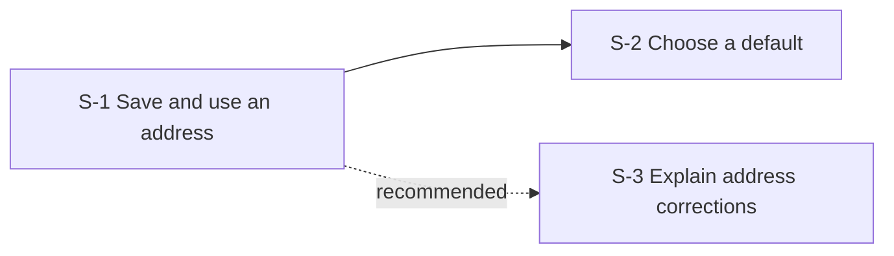

# Saved checkout addresses

## Epic goal and source

Account holders can reuse their own delivery addresses at checkout without retyping them. The original Jira Epic and agreed parent is [DEMO-700](https://tracker.example.test/browse/DEMO-700).

## Selected approach

Functional slicing: first save and use one address, then add independently demonstrable capabilities. This gets feedback on actual checkout use before adding defaults.

## Assumptions and open questions

- Proposed assumption: the existing checkout address form can be reused; this is not yet confirmed.
- Open question: which delivery region should be used for the required business value on S-3? This blocks its ticket creation.

## Slice summary

| Slice | Summary / outcome | Hard prerequisites | Recommended after | Stage |
|---|---|---|---|---|
| [S-1](slices-addresses-20261026-1000-S-1-save.md) | Save and use one address at checkout | None | None | 1 |
| [S-2](slices-addresses-20261026-1000-S-2-default.md) | Choose a default address | S-1 | None | 2 |
| [S-3](slices-addresses-20261026-1000-S-3-validation.md) | Explain invalid-address corrections | None | S-1 | 2 |

## Dependency map

Legend: solid arrows are hard prerequisites; dashed arrows labeled recommended are preferred sequencing only.

| Predecessor | Successor | Relationship | Reason |
|---|---|---|---|
| S-1 | S-2 | Hard prerequisite | A default must refer to a saved address. |
| S-1 | S-3 | Recommended sequence | Checkout feedback can improve correction messages; S-3 has no hard dependency. |

## Recommended implementation flow

1. Stage 1 — S-1: demonstrate a saved address used at checkout. No prior slice is required.
2. Stage 2 — S-2 and S-3: both can proceed together after S-1. Only S-2 requires S-1; S-3 could start earlier technically, but follows it for feedback.

## Proposed MVP boundary

S-1 alone is the first useful checkout outcome. Its prerequisite closure contains only S-1; defaults and correction-message improvements follow later.

## Jira creation results

The user explicitly approved creating these slices as children of DEMO-700.

| Slice | Title | Type | Status | Ticket | Parent Epic | Detail |
|---|---|---|---|---|---|---|
| S-1 | Save and use one address at checkout | Story | Created | [DEMO-701](https://tracker.example.test/browse/DEMO-701) | DEMO-700 confirmed | Creation and parenting confirmed. |
| S-2 | Choose a default address | Story | Failed | None | Not set | Permission error; no ticket was created. |
| S-3 | Explain invalid-address corrections | Story | Pending | None | Not set | Mandatory delivery-region value unresolved; no ticket was created. |

## Jira dependency link results

This older run approved ticket creation only; native link creation has not been authorized.

| Predecessor | Successor | Jira blocker | Jira blocked | Status | Link ID | Detail |
|---|---|---|---|---|---|---|
| S-1 | S-2 | DEMO-701 | None | Pending | None | No link was created; S-2 has no confirmed ticket and link authorization is not recorded. |

## Pilot review note

Review invalid-address feedback with checkout pilot participants before widening availability.

## Jira summary comment

Source: DEMO-700. Status: not attempted. No comment ID or link exists yet.
